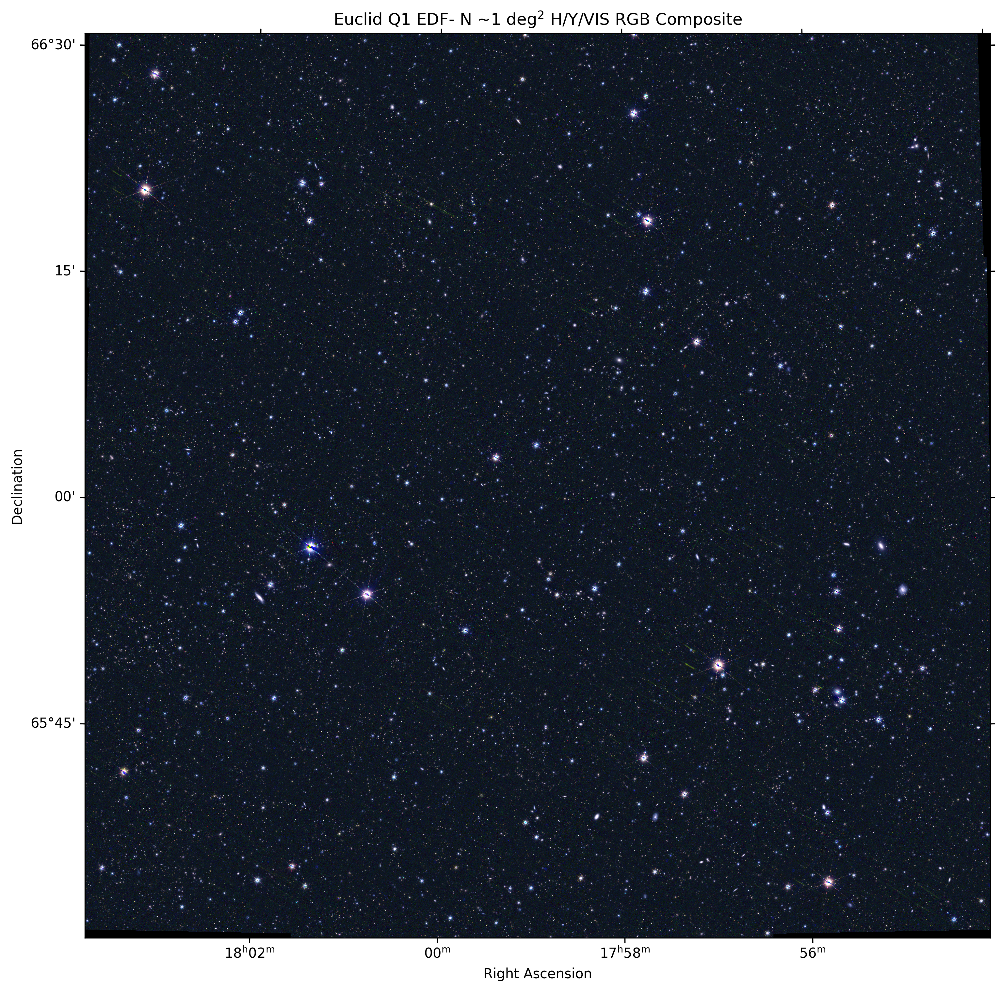

# Euclid Q1 EDF-N Mosaic
This project creates an approximately 1 deg² mosaic of the Euclid Deep Field North (EDF-N) using Euclid Q1 imaging data.

## What I did
- Queried Euclid Q1 MER imaging products through IRSA
- Identified 9 VIS tiles covering the target region
- Downloaded and cached the relevant FITS data
- Reprojected the tiles onto a common WCS grid
- Combined them into a single VIS mosaic
- Repeated the process for NISP-Y and NISP-H
- Created a false-color RGB composite

## Target region
- RA: 269.733°
- Dec: 66.018°
- Area: approximately 1 deg²

## RGB mapping
- Red = NISP-H
- Green = NISP-Y
- Blue = VIS
The final image uses percentile normalization, an asinh stretch, and small channel/gamma adjustments for visualization.

## Final result

## Main tools used
- Python
- NumPy
- Matplotlib
- Astropy
- Astroquery
- Reproject
- IRSA Euclid Q1 data

## Files
- `Euclid_Q1_EDFN_Mosaic.ipynb` — full workflow
- `Euclid_EDFN_1deg2_RGB_final.png` — final RGB mosaic

## Note
The FITS data files are not included in the repository because they are very large. The notebook downloads the required Euclid Q1 data from IRSA.
The RGB color mapping is a custom visualization and is not an exact reproduction of the official Euclid public-image processing pipeline.
